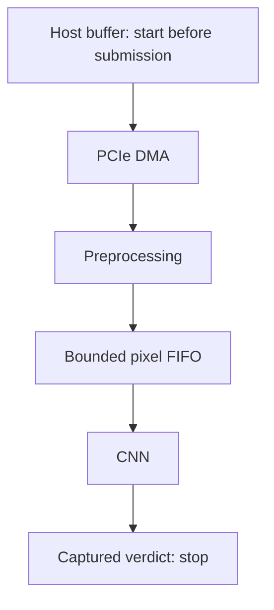
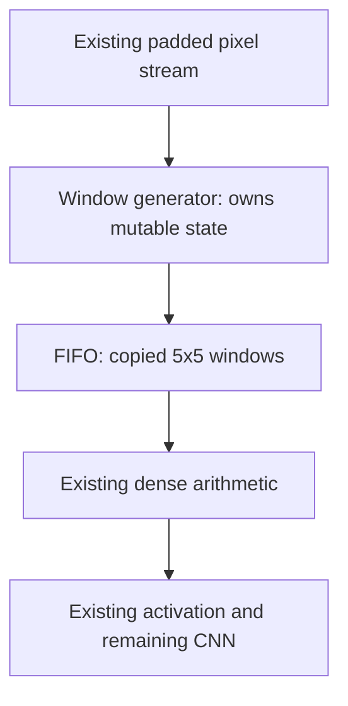

# Latency and resource optimization plan

- **Goal:** optimized [res256 checker](../reproducibility/prod_res256_coyote_accel_downsampler_hls4ml_e2e_20260524/MILESTONE_REPORT.md); host transfer → FPGA verdict.
- **Current:** corrected **D_I 520/520**, **R_S 260/260**, exact board parity on U55C-02; first-pixel launch guard fixes the reset failure. D_I/D_N benchmarks complete; latency ceiling met at **2/12 sizes**, BRAM/DSP caps unmet.
- **Production-style candidate:** R_S board parity → **R_SO_T**: single streaming IP + optimized CNN + passive timestamps → **260/260 board gate** → benchmarks. D_N retained; D_I diagnosis continues.
- **Original builds:** D_I, D_N, D_G passed implementation; D_I board parity failed.
- **Recovery builds, 2026-10-08:** [production_isolation_20261008_132304](runs/production_isolation_20261008_132304/status.json); R_O + R_S; fresh sources/IP/checkpoints; tmux + outcome-only ntfy.
- **R_O board PASS:** **260/260 exact logits; 0 verdict flips**; optimized conv0 + frozen sequential wrapper + production `RawCoyoteOverlay.predict_raw` / `CoyoteInference` / result DMA. Bitstream `7b8e828ca265…`; source/timing/RTL/artifact gates verified; completion ntfy sent. [Evidence](runs/board_benchmark_20261008_130137/diagnostics/production_isolation_board_01/R_O/isolation_validation.json).
- **R_S recovery:** attempt 2 stopped at early RTL launch stall; first frame still lacks a result at **1.3 ms**; forcing ready does not release it. Attempt 4: sequential CNN/publication helper; **60 C-simulation checks + 8/8 full RTL frames pass**; HLS IP export completed in **4 h 22 min**; Vivado project created; final build RTL gate **8/8 passed**. R_O unchanged.
- **R_S board FAIL:** **0/260 exact logits; 170 verdict flips**; original CNN + production `LOCAL_TRANSFER`/result DMA. All 10 repeats agree per input; empty input also fails. Bitstream `56b8a47ce648…`; **WNS +0.031 ns, WHS +0.009 ns**, routing errors **0**; hardware completion ntfy delivered. [Evidence](runs/board_benchmark_20261008_130137/diagnostics/production_isolation_board_01/R_S/isolation_validation.json). R_SO_T gated on corrected R_S parity with the standard driver; reset/early-launch mechanism reproduced below.
- **Board round:** [board_benchmark_20261008_130137](runs/board_benchmark_20261008_130137/status.json); `hacc-u55c-03`; D_I priority when ready; R_SO_T provides the production-style alternative; GPU deferred.
- **Board validation:** D_I attempt 1 stopped at smoke parity; repeated diagnostic mismatches. No benchmark measurements accepted.
- **Synthesized-netlist diagnostic:** one empty frame passed exact pixels/logit; **73,830 CNN cycles**. Isolated preprocessing/CNN IPs + behavioral FIFO; shell/control/routed integration not covered.
- **Board-like HLS RTL:** startup idle **20,000 cycles**, always-ready result; two empty frames pass exact pixels/logits (**73,407 / 73,805 cycles**).
- **Routed comparison:** matching RAM/URAM initialization; DSP register moves: **6 PREG, 55 AREG, 39 BREG**. Functional equivalence unproven.
- **Routed CNN diagnostic:** one empty frame passes exact pixels/logit; **73,407 CNN cycles**; startup idle **20,000 cycles**, always-ready output; uniform reset replicas. Physical timing and surrounding routed logic excluded.
- **Routed application, attempt 3:** **PASS**; exact 65,536 pixels, logit and CSR verdict; **73,407 CNN cycles**. One empty frame; uniform reset replicas, fixed zero-header boundary; PCIe/physical timing excluded.
- **Routed application, attempt 2:** all **65,536 pixels** and score **0xbf2f4000** pass; **73,407 CNN cycles**. CSR readback incomplete: exported ARREADY aliases RVALID; testbench corrected to actual read-accept condition. Prior attempt preserved; corrected full repeat passed.
- **Runtime-only attempt:** `RawCoyoteOverlay.open_direct_session`; still D_I LOCAL_READ + CSR result. Does **not** restore production LOCAL_TRANSFER + result DMA.
- **Adapter diagnostic:** 26 inputs × 10 repeats × 2 allocations (HPF/REG); all 520 logits fail exact parity; 380 verdict mismatches. HPF/REG outputs identical.
- **Production control:** 26 inputs × 10 repeats; **260/260 exact**, zero verdict mismatches. Production host code rebuilt against current Coyote library/driver: **260/260 exact** again.
- **Fresh D_I gate:** 520 calls, sequential + alternating inputs, 3 recreated contexts; **520 logit mismatches, 380 verdict mismatches**. Queue held; sink benchmarks pending.
- **Historical S_I board check:** **260/260 exact logits; 0 verdict flips**; same 26 inputs × 10 repeats. Preserved HBM-fed streaming wrapper, original CNN, CSR readback; current driver/library. [Evidence](runs/board_benchmark_20261008_130137/diagnostics/si_board_parity_01/parity_summary.json).
- **Tolerance:** per-input production maximum absolute error over 10 repeats; **0 for all 26 inputs**. No blanket historical allowance.
- **Run:** [direct_stream_20261008_002352](runs/direct_stream_20261008_002352/status.json).
- **Conv0 gate:** parity passed; pixel/arithmetic II1; all **11 paired full-CNN RTL cases passed**.
- **Attempt 4 HLS estimates:** 270,423 → **70,687 cycles**; 1.082 → **0.283 ms at 250 MHz**; **3.83×**. Estimates; paired RTL figures below.
- **Attempt 4 HLS cost:** **+485 LUT, +2,390 registers**; unchanged **233 BRAM18K, 652 DSP, 0 URAM**. Conv0 window/arithmetic **II=1**; routed costs in §3.
- **First routed timing:** setup **−0.313 ns**; hold **+0.009 ns**. Failure at shell/static AXI-stream boundary, ≈**93% routing delay**.
- **Recovery 1:** place boundary register at **SLICE_X166Y196**, matching sink placement (**+0.652 ns** on sampled paths). D_I's own optimized checkpoint; unchanged clocks/logic; fresh placement/routing output in `jobs/D_I/recovery/route_01/`.
- **Final recovered timing:** WNS **+0.035 ns**, WHS **+0.009 ns**; setup/hold/pulse-width failures **0**; routing errors **0**.
- **Attempt 4 RTL:** first CNN pixel → score **73,810–73,830 cycles**, ≈**0.295 ms at 250 MHz**, **3.71× versus the original FPGA CNN**; synthetic 0–4 MiB cases with stalls. Host/board latency pending.
- **Checker retry:** outer CNN launch control stalled frame completion; remove outer DATAFLOW, retain internal CNN streaming. Attempt 3 preserved; fresh attempt 4 passed C-simulation/control/RTL gates.
- **Wrapper fix:** pristine and optimized CNN RTL passed all **11 frames**, exact pixels/logits, stalls and streaming overlap. Tested RTL/data files match actual build outputs byte-for-byte.
- **Scope:** direct streaming; no HBM staging; no actual PR of inputs.

### Build-host restart — 2026-10-09

- [x] Host: `hacc-build-02`; **32 physical cores / 64 threads; 339 GiB available RAM** at admission.
- [x] Preserve interrupted D_I/R_S attempts; verify unchanged source hashes and completed HLS exports.
- [x] Launch D_I + R_S concurrently at **15:41 CEST**; local SSD; independent CPU groups; shared backups.
- [x] RTL gate: D_I **11/11 reused with identical source/export hashes**; R_S **8/8 repeated**, driver reset included.
- [x] Fresh D_I RTL repetition: **11/11 paired frames**, exact outputs; second reset, startup idle and stalls. CNN **274,286 → 73,944 cycles**; [evidence](runs/parallel_resume_20261009_1550/diagnostics/D_I_rtl_repeat_20261009_1653/results/direct_rtl/status.json).
- [x] First-hour supervision complete; both shell syntheses passed; checkpoints backed up; checker synthesis running; **0 failed synthesis subruns**.
- [x] Finish synthesis + implementation + bitstream generation; both images complete.
- [x] Routed timing + bitstream/hash gates: **D_I WNS +0.044 ns; R_S +0.022 ns; WHS +0.009 ns each**.
- [x] Current board round: `hacc-u55c-02`; [fresh results](runs/board_benchmark_u55c02_20261009_2345/); D_I **520/520** → R_S **260/260** → **5,280 benchmark calls**.
- Campaign: [parallel_resume_20261009_1550](runs/parallel_resume_20261009_1550/status.json).
- Worker/monitor: `build_campaign/resume_parallel.py`; independent tmux monitor; ntfy on hardware outcomes only.
- First-hour active supervision; persistent workers/monitor afterward. No board programming or benchmarking in this restart.

### U55C-02 board round — 2026-10-09

- Results: [board_benchmark_u55c02_20261009_2345](runs/board_benchmark_u55c02_20261009_2345/status.json); previous host evidence preserved.
- [x] D_I: **520/520 exact logits; 0 verdict flips**; 26 inputs, sequential + alternating orders, 3 runtime contexts; standard driver.
- [x] R_S: **260/260 exact logits; 0 verdict flips**, production runtime + standard driver.
- [x] D_I → D_N: **12 sizes × (20 warmups + 200 measured)** each; **5,280 calls passed**; separate smoke/pilot **108 calls**.
- [x] Both completion ntfy messages delivered; **D_N left loaded**, standard driver.
- [x] tmux tracking; ntfy on benchmark outcomes only.

### Extended comparison — 2026-10-09–10

- [x] R_O + R_S: **2,640 calls each**, production runtime; fresh per-case + persistent parity gates passed.
- [x] Original frozen production checker: **260/260 fresh parity**, **2,640 benchmark calls**; non-streaming, original CNN.
- [x] Five variants total: **13,200 main-sweep calls**, **12,000 measured + 1,200 warmups**; same 12 inputs.
- [x] Save raw observations, event tables, source/artifact hashes; completion ntfy delivered; D_N restored.
- [x] [Report with figures](reports/u55c02_20261009/REPORT.md): latency comparison, D_I pipeline timestamps, overlap/stalls, routed resources.
- **4 MiB host medians:** original **1.434 ms**, R_O **0.631**, R_S **1.106**, D_I **0.357**, sink **0.335**.
- **Near-128 MiB:** original **11.612 ms**, R_O **10.809**, R_S **10.537**, D_I **10.534**, sink **10.513**.
- **D_I–sink ≈21–23 µs:** transport hides most CNN work; last pixel → verdict **21.33 µs**. Uninstrumented variants expose host timing only.

### Progress checklist

- [x] Build seven smaller hello-world bitstreams; calculate eight-size grid.
- [x] Select additional latency optimization: decouple conv0 window generation and arithmetic (§4).
- [x] Retire S_I from active preparation/scheduling; preserve historical artifacts.
- [x] Implement direct streaming and timestamps; control RTL passes all three variants.
- [x] Implement conv0 window FIFO; verify window/output parity and achieved II1.
- [x] C-simulation: exact pixels/logits on 11 boundary cases + three real files, 5.28–53.10 MiB.
- [x] GPU-bridge RTL: forwarding/TIDs, stalls, FIFO wrap, consecutive frames, returned verdict and timestamps.
- [x] Verify full-CNN RTL parity and cycle reduction.
- [x] Validate preprocessing/CNN parity and streaming in RTL.
- [x] Validate D_I/D_N board streaming and host/FPGA clock alignment; maximum bracket uncertainty **1.25 µs**.
- [x] Build transport sink + GPU bridge; final timing passed; source/artifact hashes verified.
- [x] Finish checker build; verify routed timing/resources and artifact hashes.
- [x] Prepare real-bitstream and synthetic size sweeps; reference pixels/logits verified.
- [x] Implement persistent production-derived direct runtime; preserve production `predict_raw`.
- [x] Test HPF versus REG; mismatch persists, all 260 paired results identical.
- [x] Establish frozen production board reference and per-input tolerances.
- [x] Isolate current driver/library on production hardware; exact parity retained.
- [x] Runtime/analysis unit checks: **12 passed**.
- [x] Isolated synthesized IP + board-like HLS RTL checks passed.
- [x] D_I HLS RTL + CSR controller: **11/11 frames**; exact score/decision readback, tags/status/counts; PCIe shell/routed hardware excluded.
- [x] Constant-input diagnostic: **256 bytes × 65,536-byte frames**; **0/256 exact**. Inversion/sign-bit/bit-reversal mappings: **0 matches** each.
- [x] Read-only CSR width check: **2,900/2,900** native 64-bit versus split 32-bit reads agree; score stable at **0x3e9c0000**. No MMIO-width discrepancy; internal capture correctness still unproven.
- [x] Routed-CNN functional simulation: **one empty frame passes**; D_I board mismatch remains unexplained.
- [x] Add production-path isolation builds to recovery goal; preserve original campaign.
- [x] Launch R_O + R_S workers; original production host sources, monolithic wrappers, result DMA.
- [x] R_O and initial R_S pass **26 inputs × 2 orders + 8 boundary references** C-simulation gate.
- [x] Corrected R_S helper: **60 C-simulation checks pass**; fresh hardware attempt 4 started; prior attempts preserved.
- [x] Early launch RTL: **R_O 2/2**, corrected **R_S 2/2**; exact results, startup idle, output backpressure.
- [x] Routed application functional check: **one empty frame passes** exact pixels/logit/CSR; physical timing and PCIe excluded.
- [x] Historical S_I board parity: **260/260 exact; 0 verdict flips**; diagnostic only, D_I benchmark gate unchanged.
- [x] Long-idle RTL: **1,048,576 cycles** before input/between frames/after final frame; **2/2 exact** pixels/logits/CSR readbacks; no unsolicited results; **73,407 CNN cycles** each.
- [x] R_O: **8/8 actual HLS RTL frames pass**; 0–4,194,241 bytes; input gaps, partial KEEP, output backpressure, consecutive frames. Full bitstream built; **WNS +0.027 ns, WHS +0.009 ns**; setup/hold/pulse-width failures **0**, routing errors **0**. Board: **260/260 exact logits**, production runtime; source/artifact hashes verified.
- [x] R_S early full RTL: **8/8 exact logits**; 0–4,194,241 bytes, partial KEEP, input gaps, output backpressure, consecutive frames. Tested RTL/data hashes match current generated files; final build gate also **8/8 passed** (`jobs/R_S/early_full_check/`).
- [x] R_S synthesis + linking + placement passed; placement **40 min 15 s**, **0 errors**. Routing + post-route optimization passed: **WNS +0.031 ns, WHS +0.009 ns**; final reports pass, **0 routing errors**; bitstream generation complete; board parity **0/260**, **170 verdict flips**.
- [x] Finish both builds; verify timing/hashes; notify each hardware outcome.
- [x] Queue sequential production-runtime board validation: R_O → R_S; programming gated on timing, hashes, full **8-frame RTL**; **4 handoff/recovery tests pass**.
- [x] R_O: identical **26 inputs × 10 repetitions** through production `RawCoyoteOverlay.predict_raw`; **maximum error 0**.
- [x] Persistent production runtime: `RawCoyoteOverlay.open_production_session`; unchanged C++ `LOCAL_TRANSFER` + result DMA; **260/260 exact R_O logits**, one context across all 26 sizes/inputs; **2 lifecycle tests pass**. Allocation/preparation outside timed calls; host-observed timing only. [Evidence](runs/board_benchmark_20261008_130137/diagnostics/production_persistent_R_O_01/isolation_validation.json).
- [x] R_S: same production-runtime board gate; **0/260 exact**, **170 verdict flips**; preserve failed evidence.
- [x] Recover R_S parity: first-pixel launch guard; corrected image **260/260 exact** with standard driver on U55C-02.
- [x] Reproduce board errors in RTL: configuration reset → **20,000 idle cycles** → driver reset → first frame; **D_I `3f97e000`, R_S `3f944000`**, matching hardware. Expected `bf2f4000`; input pixels unchanged.
- [x] Identify retained state: convolution position/stride counters initialize at configuration; control reset does not clear them. Streaming CNN can process padding before host input.
- [x] Implement shared first-pixel launch guard; unchanged pixels, weights, runtime/result interfaces.
- Guard HLS cost, D_I CNN: **+7 LUT, +1 FF**; unchanged **233 BRAM18K / 652 DSP / 0 URAM**. Estimates; routed cost pending.
- [x] Guard C-simulation: **60 R_S checks; 11 D_I boundaries**, exact logits.
- [x] D_I guard validation: fresh HLS + **11/11 full RTL frames**, exact pixels/logits; **73,938 CNN cycles**; second reset + **20,000 idle cycles**.
- [x] R_S guard validation: fresh HLS + **8/8 full RTL frames**; second reset + output stalls. [Evidence](runs/frame_start_recovery_20261009_0134/).
- [x] Board causal check: same R_S bitstream/runtime, diagnostic driver without second reset → standard driver restored. **260/260 pass without second reset; 0/260 with standard driver**, original failed CSV reproduced exactly; standard driver restored. Diagnostic only.
- [x] Launch corrected D_I + R_S: **02:10 CEST, October 9**; fresh sources/IP/checkpoints; parallel preparation, shared implementation memory permit; maximum **5 workers**. [Live queue](runs/frame_start_builds_20261009_0140/status.json).
- [x] Fresh build synthesis passed: D_I **15 min 18 s**; R_S **16 min 07 s**. Export running.
- [x] Fresh synthesis RTL matches reset-tested preflight byte-for-byte: **D_I CNN 192/192 files; R_S wrapper 209/209 files**. [Hashes](runs/frame_start_recovery_20261009_0134/fresh_build_rtl_comparison.json). Final packaged RTL, routing and board gates remain required.
- [x] Corrected hardware with standard driver: **D_I 520/520; R_S 260/260** on U55C-02.
- [x] Attach automatic board handoffs: D_I priority, **520** sequential/recreated-context checks; R_S **260** production-runtime checks; exclusive device lock.
- [x] Bind benchmark admission to exact bitstream, source manifest, standard driver, runtime libraries and parity evidence.
- [x] Attach [benchmark handoff](runs/frame_start_recovery_20261009_0134/benchmark_handoff/status.json): corrected D_I **520/520** → smoke → pilot → **2,640 calls each for D_I then D_N**; preserve failed attempts; exclusive board lock.
- [ ] After R_S board parity: combine its **single-IP streaming wrapper + internal 32-token FIFO** with R_O’s optimized CNN.
- [ ] Validate preprocessing/CNN parity; consecutive frames, input/output stalls.
- [x] Prepare standalone passive monitor + read-only host access; **3 RTL frames / 12 software tests pass**.
- [x] Isolated packaged R_S: passive taps + monitor; **8/8 full-CNN RTL frames**, exact pixels/logits/event cycles, stalls and consecutive frames.
- [x] R_SO_T shell wiring: production DMA + read-only observer; actual Coyote interface elaboration passed.
- [x] Prepare gated R_SO_T build integration; **4 prerequisite/packaging-gate tests pass**. Shared R_S wrapper + R_O conv0; fresh IP export; combined reset/pixel/logit/timestamp RTL before implementation.
- [x] Attach [R_SO_T handoff](runs/frame_start_recovery_20261009_0134/R_SO_T_handoff/status.json): wait for corrected R_S **260/260 standard-driver parity**; recheck both prerequisite source identities; share replacement campaign's implementation memory permit.
- [x] Attach R_SO_T board handoff: fresh routed timing/hash/RTL gates → production DMA → **260 parity + passive-capture checks**; no benchmark admission yet.
- [x] R_SO_T admission audit: replay **260 saved captures** against result rows; reject stale IDs, mismatched results and altered interval decoding; **2 tests pass**.
- [x] Attach [R_SO_T benchmark handoff](runs/board_benchmark_20261008_130137/R_SO_T/handoff.json): board gate → D_I priority **if ready** → smoke/pilot/**2,640 calls** → restore D_N. Unavailable D_I does not block R_SO_T. **4 supervisor/priority tests pass**; actual benchmark pending.
- [ ] Repeat full integration checks on combined optimized R_SO_T before its hardware build.
- [ ] Build **one instrumented R_SO_T** candidate; fresh sources/IP/checkpoints; record hashes.
- [ ] R_SO_T: routed timing → **260/260 board parity** → clock alignment → benchmarks.
- [x] Isolate D_I/R_S failure: premature CNN launch + retained convolution state across driver reset; RTL reproduction and board driver A/B established the mechanism.
- [x] Fix D_I; preserve optimized streaming + timestamps; **520/520 parity**, full benchmark correctness/clock gates passed.
- [x] Benchmark D_I/D_N; attribute costs; compare targets. R_SO_T remains a separate unbuilt candidate.

## 1. Performance targets

### Data path

- Interface: `STRM_HOST` → `axis_host_recv`; complete upload every trial.
- Input: raw length + bytes; **65,536 output pixels**.
- Preserve sampling, padding, normalization, weights, and classification threshold.
- Include per-trial submission; D_I/D_N also include arming. R_SO_T captures automatically; stop at FPGA verdict.
- Separate setup: file loading, buffer allocation/registration, design installation.
- Separate counts: raw bytes, header, alignment padding.

### Latency

- Target: **upper 95% confidence bound of FPGA p95 ≤90% of GPU median**.
- Include clock-alignment uncertainty; interpolate targets linearly in bytes.
- [GPU baseline](../../GPU_BASELINE.pdf): P2P transfer + publication/polling; excludes HBM stalls.
- Definitive comparison requires matching source location and timing boundaries.

| Size | GPU median, ms | FPGA p95 ceiling, ms |
| --- | ---: | ---: |
| 64 KiB | 0.190 | 0.171 |
| 256 KiB | 0.200 | 0.180 |
| 1 MiB | 0.250 | 0.225 |
| 4 MiB | 0.450 | 0.405 |
| 16 MiB | 1.240 | 1.116 |
| 64 MiB | 4.390 | 3.951 |
| 128 MiB | 8.590 | 7.731 |

| Compute | Production FPGA estimate, ms | GPU reference, ms |
| --- | ---: | ---: |
| Preprocessing + CNN | 3.346 | 0.165 |
| CNN | 1.082 | ≈0.147–0.148* |

- *Derived from rounded labels. New checker latency: **unmeasured**.

### Resources

- Scope: routed checker wrapper, including preprocessing, CNN, buffers, control.
- Report shell overhead and instrumentation separately.

| Resource | ≤10% limit |
| --- | ---: |
| LUT | 130,368 |
| Registers | 260,736 |
| BRAM, 36-Kbit equivalents | 201.5 |
| URAM | 96 |
| DSP | 902 |

### Small-bitstream evidence

- Existing corpus: **524 files; 28.92–53.10 MiB**.
- Hello-world: rebuilt with smaller floorplans; all seven pass implementation.
- **HR = 5.284 MiB:** smallest generated sample; absolute/PR-valid minimum unproven.
- Size is nonmonotonic with floorplan area; earlier **0.65–4 MiB** estimates unmet.
- No new hello-world builds or PR validation in this campaign.

| Build | Bytes | MiB | Note |
| --- | ---: | ---: | --- |
| H16 | 18,876,484 | 18.002 | 16 regions |
| H8 | 10,160,176 | 9.689 | 8 regions |
| H4 | 12,004,440 | 11.448 | 4 regions |
| H2 | 6,222,564 | 5.934 | 2 regions |
| H1 | 5,544,256 | 5.287 | Relocated for BRAM |
| HN | 5,572,388 | 5.314 | Narrowing did not reduce bytes |
| HR | 5,540,996 | **5.284** | Smallest; X2Y1 |

- Evidence: [state](runs/20261001_184524/status.json), [jobs](runs/20261001_184524/jobs/), [attempts](runs/20261001_184524/attempts/).
- Partial files: `jobs/<ID>/build/bitstreams/config_0/vfpga_c0_0.bin`.

## 2. Implementation and bottleneck experiment

### Production-path recovery — before benchmarks

| Build | Preprocessing → CNN | Conv0 | Host/result path |
| --- | --- | --- | --- |
| R_O | Frozen sequential `model_wrapper`; 65,536-token buffer | Optimized | Frozen `CoyoteInference`; LOCAL_TRANSFER; float result DMA |
| R_S | One wrapper; preprocessing DATAFLOW → 32-token FIFO → sequential CNN/publication helper | Original | Same production path |

- R_O: byte-identical production wrapper, preprocessing, host source; isolated conv0 call/helper change.
- R_O loading requirement: unchanged res256 `RawCoyoteOverlay.predict_raw` → `CoyoteInference` → `LOCAL_TRANSFER` → result DMA; no direct-session/CSR-result adapter.
- Both: raw length header **64 B** + **exact payload length**; HPF buffers; **4 B result DMA**; `RawCoyoteOverlay.predict_raw`.
- Board gate: **26 inputs × 10 repeats**; reuse frozen per-input tolerances (**zero** here); reject same-verdict logit errors; save separate isolation validation.
- Production result converter: **LAST=0**, KEEP unspecified; preserve length-driven DMA behavior.
- D_I differences: padded full-beat input, CSR arming, split HLS IPs, external FIFO, always-ready result, CSR capture.
- Shell source differs from frozen production: current MMU adds DMA-fragment LAST forwarding/rewriting. Clock/reset BD source matches. Production application/runtime path restored in R_O/R_S; shell equivalence unproven.
- Current evidence: production **260/260 exact** on current driver/library; D_I **520/520 logit mismatches**. Root cause unproven.
- Empty input also fails D_I: raw payload transfer alone cannot explain every failure.
- Check: launch/reset, input framing, pixel order, output conversion/capture, IP packaging, routed functionality.
- Controller diagnostic passed: real D_I HLS RTL + CSR controller; **11 frames**; score/decision readback and pixel counts.
- Constant sweep: D_I input → score **69,999 cycles** for all 256 cases; first empty frame in HLS RTL **73,407 cycles**. Different behavior; no root-cause claim.
- Two build workers; R_O uses **4 tool threads**. R_S uses **2 synthesis subjobs × 1 thread**; implementation retains 4 threads.
- R_S handoff applied after **8/8 final RTL**; completed HLS/IP retained, source hashes unchanged. Synth/link/bitgen overlap only when memory permits: **≥24 GiB available**, **12 GiB** stage reservation, other-build growth allowance and **8 GiB margin**. Full-device place/route stays serialized (**18 GiB** entry guard).
- S_I/D_I Coyote snapshots: **356 HDL files, 7 static checkpoints, 20 runtime files, 4 CMake modules identical**. Generated settings remain different: HBM/card input versus direct host; host-port count and application wrappers.
- S_I/D_I prepared firmware: **32 weight files + 58 nnet helpers + 3 configuration/API headers identical**; excludes conv0 call/helper, wrappers and physical configuration.
- Host: **62 GiB RAM**. Unused hugepage reservation temporarily reduced **16 → 4 GiB** through the explicitly permitted sysfs command; **12 GiB released**. R_S synthesis overlapped R_O implementation; linking now overlaps bitstream generation. Tmux monitor restored **16 GiB** after the campaign; original failed sysctl attempt preserved.
- S_I: header-dependent CNN launch; **65,536-token** FIFO. R_S: DATAFLOW start tokens; **32-token** FIFO. Both use original CNN; only S_I passes board parity. Check launch/reset/stall behavior; root cause unproven.
- Same **250 MHz** target; no HBM; one host-stream destination; passive shell debug keepalive.
- Diagnostic isolation only; production ABI retained. Stage instrumentation/benchmark adaptation follows correctness.
- Preserve validation attempts under `attempts/`; no source/IP/checkpoint reuse after edits.
- R_S: stop failed launch-control implementation before routing; replacement keeps preprocessing/CNN overlap and production result DMA.

### R_SO_T: production-style streaming candidate

- **State:** standalone observer prepared; combined checker integration/build gated on R_S board parity.
- **Prerequisite verifier:** `isolation_evidence.py`; current source/bitstream/runtime/driver hashes + **26 × 10 CSV rows**; **4 rejection/admission tests pass**. R_O evidence revalidated; R_S rejected by board correctness gate.
- **Observer RTL:** **3 complete frames** pass; stalls, automatic next-frame capture, read-only CSR, invalid-result rejection. [Test state](runs/passive_monitor_check_20261009_0029/status.json).
- **Host support:** optional read-only CSR on the existing production context; **12 runtime/decoder/benchmark/validation tests pass**. Read-only native extension compiles against the current Coyote library; production `host_libs.cpp` unchanged. Full IP integration and board validation pending.
- **Tap export:** additive-only Verilog/VHDL edits; **2 source-contract tests pass**; Vivado IP integrity/catalog checks pass. [Evidence](runs/passive_export_check_20261009_0034_02/status.json).
- **Full-CNN observer check:** isolated packaged R_S RTL; **8/8 frames passed**; exact FIFO pixels, logits, timestamp cycles, stalls/consecutive frames; no board changes. [State](runs/passive_full_rtl_20261009_0040_02/status.json).
- **One HLS IP:** preprocessing → **32-token internal FIFO** → optimized CNN.
- Production `RawCoyoteOverlay` / `CoyoteInference`; unchanged input and result DMA.
- **64-byte header + exact raw bytes**; **4-byte float result DMA**.
- Passive taps: existing FIFO write/read handshakes; no additional data queues.
- Small RTL monitor; **one 64-bit FPGA cycle counter**; read-only registers.
- Read timestamps **after result DMA completes**; capture resets on next frame’s first accepted beat.
- **One outstanding frame**; no software arming, verdict capture control, or datapath gating.
- Monitor never controls ready, reset, or CNN launch.
- Maintained C++/RTL files; Python handles isolation, variant selection, configuration, scheduling, monitoring.
- Gates: pixel/logit parity; consecutive frames; stalls; unchanged outputs; exact timestamp boundaries; routed timing; **260/260 board checks**.
- Board validator prepared: `production_control.py --persistent --passive-monitor`; verify logits + five events/counts/frame IDs on every call; clock alignment remains a separate gate.
- Maximum **5 builds**; memory-aware overlap; shared whole-device implementation lock.
- Outcome-only ntfy; preserve failed attempts; no synthesis-equivalence claim before evidence.

| Timestamp | Event |
| --- | --- |
| `T_in` | First input beat accepted, **including length header** |
| `T_pixel_first` | First preprocessed pixel written into internal FIFO |
| `T_pixel_last` | Last preprocessed pixel written into internal FIFO |
| `T_cnn_first` | First pixel consumed by CNN |
| `T_verdict` | Result first valid at output; independent of output-ready |

| Measurement | Calculation |
| --- | --- |
| Preprocessing startup | `T_pixel_first − T_in` |
| Preprocessing elapsed | `T_pixel_last − T_in` |
| CNN elapsed | `T_verdict − T_cnn_first` |
| CNN tail | `T_verdict − T_pixel_last` |
| FPGA pipeline latency | `T_verdict − T_in` |

- **Overlap + stalls included; do not sum preprocessing and CNN elapsed.**
- D_I’s first-raw-byte event excludes the header; keep boundary differences explicit.
- Five taps do not independently measure last-byte transfer time; use the sink/host evidence with scope labelled.
- Host start: before production submission; preparation/allocation outside timing.
- Host verdict: after production result DMA; report separately from calibrated FPGA verdict time.

### Implementation checks

- [x] Implement conv0; pass isolated parity/HLS gate before full builds.
- [x] Use shared C++ helpers, explicit wrappers, SystemVerilog parameters.
- [x] Keep Python for isolation, variants, floorplans, configuration, scheduling, monitoring.
- [x] Stream preprocessing → CNN through a 32-pixel FIFO; pass stall/overlap RTL checks.
- [ ] Tune FIFO using board occupancy/stall measurements.
- [x] Register ABI v3; isolate per-trial events/results; control RTL checks passed.
- [x] C-simulation pixel/logit parity; verdict control RTL checks passed.
- [x] C-simulation: **65,536** and **4,194,241-byte** boundaries, adjacent lengths, partial beats.
- [x] Test consecutive frames, stalls, backpressure, early CNN consumption in real-IP RTL.
- [x] Use fresh build directories/IP/checkpoints; record source hashes.
- [x] Preserve frozen production artifacts; pass routed setup/hold/pulse-width checks.

### Events and intervals

| Timestamp | Capture point |
| --- | --- |
| Host start | Before per-trial arming/submission |
| DMA entry / return | Host transfer invocation |
| First / last raw byte | Payload accepted at checker |
| First / last processed pixel | Successful write into pixel FIFO |
| First / last CNN input | Successful read from pixel FIFO |
| Published score / verdict | Score accepted by controller / decision captured |
| Host completion | Host observes result |

- “First/last byte preprocessed” = first/last sampled pixel produced.
- D_I/D_N events above; R_SO_T uses the five capture points specified earlier.
- FIFO/input events: accepted handshakes; R_SO_T verdict: first valid. One counter domain.
- Record byte/token counts, FIFO occupancy, starvation, backpressure.

| Breakdown | Interval |
| --- | --- |
| Host submission | Start → DMA entry; DMA call duration |
| Transfer | First → last raw byte; effective bandwidth |
| Preprocessing | First raw byte → last pixel; first → last pixel |
| Inference | First CNN input → published score; includes input waits and float conversion |
| Inference tail | Last pixel produced → verdict |
| Decision / host observation | Published score → verdict; verdict → host completion |

- **Overlapping intervals: do not sum.** Sink/checker subtraction is not isolated compute cost.
- DMA acknowledgment may precede the checker's last payload handshake; upstream buffering. Keep both timestamps; no ordering assumption between them.
- [x] Calibrate host/FPGA clocks with bracketed counter reads before/after blocks.
- [x] Quantify offset, drift, synchronization/read uncertainty.
- [x] Report host-start → FPGA-verdict with uncertainty.
- [x] Report host-start → host-observed completion as an upper bound.
- [x] Alignment passed: uncertainty **1.04–1.25 µs**, below **1%** of each target ceiling.

### Size sweeps

| Synthetic size | Raw bytes | PDF GPU median, ms |
| --- | ---: | ---: |
| 4 MiB | 4,194,304 | 0.450 |
| 16 MiB | 16,777,216 | 1.240 |
| 64 MiB | 67,108,864 | 4.390 |
| Near-128 MiB | **134,217,664** | 8.590 at full 128 MiB |

- Synthetic inputs: repeat/truncate benign HR; timing only.
- Near-128: **64 bytes below 128 MiB**; existing hardware limit; approximate PDF comparison.
- D_I/D_N framing: **64-byte header** + payload + alignment padding; R_SO_T: header + exact payload, plus **4-byte result DMA**. Account for differences explicitly.
- Real sweep, MiB: **5.284, 11.448, 18.002, 28.919, 32.580, 39.367, 46.292, 53.098**.
- Real files unchanged; hashes, exact sizes, provenance, reference logits in `inputs.json`.
- D_I/D_N runner/analyzer: `build_campaign/board_benchmark.py`; ABI **v3**, IDs **7/8**.
- Admission: explicit `hardware_selection.json`; parity bound to bitstream/source/standard-driver hashes. Collection verifies installed identity before/after; exclusive board lock. **3 hardware-identity + 12 runtime/timestamp tests pass**; fresh parity still required.
- R_SO_T: `production_benchmark_queue.py` + `production_benchmark.py`; passive ABI **v1**, production DMA; **20 + 200 trials**, **32 + 32 clock reads**. Admission/launch attached; hardware and board gates pending.
- R_SO_T labels: `pre_submit`, blocking `production_predict`, calibrated host → ingress/verdict; **no isolated transfer-time claim** from five taps.
- Historical S_I analyzer: inactive for this round.

### Trial protocol and budget

- **One session per variant**, both sweeps; **batch 1**; order seed **20261002**.
- **20 recorded warm-ups + 200 measured trials per case**.
- Summaries: measured-only, all calls, first call; no independent cold-start campaign.
- **D_I priority if ready**; otherwise benchmark R_SO_T without waiting for D_I. D_N after the first validated checker; D_I follows its fix. Leave D_N loaded at the end; **GPU deferred**.
- Current host: `hacc-u55c-02`; U55C device **1**, serial `XFL1O5FZSJEIA`; PCIe **Gen3 ×16**. Previous-host results preserved.
- Driver rebuilt for **6.8.0-138-generic**; original module targets **6.8.0-111**.
- Pin **CPU 2 / NUMA 0**; R_SO_T uses production **HPF** buffers; record allocation for each variant. Retain `ondemand` governor; record competing load.
- [x] Before/after-case context snapshots: CPU affinity/governor/frequency, CPU counters/load, hugepages/memory, kernel and PCIe link. Outside measured calls; `*.environment.jsonl` + content hashes.
- Exclude loading/allocation/programming; include submission and any variant-specific arming; full upload every trial.
- Complete transfer + verdict before next frame; R_SO_T reads timestamps after result DMA. Preserve failures separately.
- Calibration: **32 bracketed reads before/after each case**; affine fit; uncertainty **≤1% of target ceiling**.
- Pilot: min/max synthetic inputs, **2 warm-ups + 10 trials**; separate from main counts.
- Smoke: **15 cases × 2 trials**; separate from main counts.

| Scope | Measured | Warm-ups | Total |
| --- | ---: | ---: | ---: |
| D_I: 4 synthetic + 8 real | 2,400 | 240 | 2,640 |
| D_N: 4 synthetic + 8 real | 2,400 | 240 | 2,640 |
| R_SO_T: 4 synthetic + 8 real | 2,400 | 240 | 2,640 |
| **Combined** | **7,200** | **720** | **7,920** |

- Upper p95 confidence bound: **196th ordered sample of 200**, using calibrated latency upper endpoints.
- Per-case, single-session evidence; no between-session consistency claim.
- Budget: **2–4 h** software preparation + **1–2 h** board validation/sweeps; debugging extra.
- tmux: `coyote-benchmark`, session `benchmark_board_benchmark_u55c02_20261009_2345`.
- ntfy: **each benchmark passed/failed or required-input blocker**; no periodic alerts.
- Outputs: CSV/JSON, plots, updates here, chat summary; **no new narrative report**.
- Final board state: **D_N loaded**.

### Builds

| Build | Purpose | State, 2026-10-08 |
| --- | --- | --- |
| D_I: instrumented direct-stream checker | Latency/resources | Built, 12:11 CEST; recovery 1 |
| D_N: matched transport-only sink | Transport capacity | Built, 05:26 CEST |
| D_G: GPU P2P bridge | Forward input; capture GPU verdict | Built, 05:26 CEST |

- D_I final timing: **WNS +0.035 ns; WHS +0.009 ns**; setup/hold/pulse-width failures **0**.
- D_I outputs: `jobs/D_I/recovery/route_01/bitstreams/`; use recovered outputs.
- D_N/D_G final timing: **WNS +0.044 ns; WHS +0.009 ns**; no failures.
- Source/artifact hashes: each completed job's `artifact_manifest.json`; board validation pending.

- **Three builds; no instrumentation-disabled or per-size builds.**
- Checker includes the validated conv0 change (§4); sink remains transport-only.
- Isolated conv0/full-CNN HLS synthesis and RTL checks precede full builds; budget separately from the **4–10 h** implementation estimate.
- Target checker clock: **250 MHz**; match shell/interfaces/clocks.
- Capacity: **up to five concurrent builds**.
- Budget: **4–10 h/attempt**; prior successful attempts **3.8–9.8 h**.
- Development/retries extra; parallel runtime depends on machine load.
- Tracking: **tmux; silent inspection every 30 minutes**.
- ntfy: **actual hardware-build termination/success or required user input only**.
- Validation jobs: local logs only; no notifications.
- Topic: `https://ntfy.sh/coyote-build-sdeheredia`.

### GPU pass-through

- Path: **host → FPGA → GPU memory → preprocessing → CNN → P2P verdict read → FPGA**.
- Transfer first; GPU compute starts after completion/visibility synchronization.
- Forward payload, byte enables, frame boundaries, and transaction IDs unchanged.
- Frame: 64-byte length header + aligned payload; result: 64 bytes, score + magic + trial ID.
- Timestamp ingress/egress, DMA completion, GPU stages, and FPGA verdict capture.
- HIP events: GPU stages only; host/FPGA clock alignment remains required.
- GPU baseline adapter: **blocked on original source/model and target GPU host**.
- Bridge hardware build proceeds independently; no substitute GPU model.
- Board P2P/coherence validation and benchmark sweeps: **deferred**.

## 3. Identified bottlenecks and cost attribution

- Board evidence: [D_I summary](runs/board_benchmark_u55c02_20261009_2345/D_I/attempt_01/full.summary.csv), [sink summary](runs/board_benchmark_u55c02_20261009_2345/D_N/attempt_01/full.summary.csv).
- **200 measured + 20 recorded warmups/size/variant**; single session; all parity/event/clock gates pass.

| Payload | D_I median, ms | D_I p95 upper 95%, ms | Sink median, ms | Target ceiling, ms |
| --- | ---: | ---: | ---: | ---: |
| 4 MiB | 0.355 | 0.358 | 0.333 | 0.405 |
| 16 MiB | 1.340 | 1.341 | 1.318 | 1.116 |
| 64 MiB | 5.279 | 5.398 | 5.257 | 3.951 |
| 128 MiB − 64 B | 10.532 | 10.653 | 10.510 | 7.731 |

- Latency ceiling met: **4 MiB synthetic + 5.284 MiB real**; **2/12 sizes**. Larger tested sizes miss; crossover not localized.
- Near-128 MiB: reception **10.506 ms**, ≈**12.78 GB/s**; checker total **10.532 ms**, sink **10.510 ms**.
- Host submission overhead: ≈**1.3 µs**; last preprocessed pixel → verdict: **21.33 µs** across main sweep.
- First CNN pixel → score: **0.350 ms at 4 MiB**, **10.527 ms near 128 MiB**; includes transport stalls. Small-input smoke interval ≈**0.296 ms**; only **2 repeats/input**.
- Near-128 MiB preprocessing/CNN overlap: ≈**10.506 ms**; intervals are not additive; checker-minus-sink is not isolated compute.
- PCIe: **Gen3 ×16**, configured **512-byte payload/read request**; no link downgrade. Sink shows shared transport dominates large-input latency; exact limiting mechanism remains to isolate.
- PDF uses **GPU P2P**; this round uses **host → FPGA DMA**. Reference comparison only; GPU experiment deferred.

- Routed wrappers (`inst_user_wrapper_0`; includes Coyote interfaces and ILA):

| Build | LUT | Registers | RAMB36 | RAMB18 | DSP | URAM |
| --- | ---: | ---: | ---: | ---: | ---: | ---: |
| D_I checker, corrected | 67,143 | 86,435 | 348 | 12 | 1,328 | 11 |
| D_N sink | 7,788 | 12,616 | 18 | 4 | 0 | 0 |
| D_G GPU bridge | 9,646 | 14,425 | 27 | 5 | 0 | 0 |
| R_O sequential diagnostic | 63,880 | 83,030 | 372 | 10 | 1,328 | 11 |
| R_S streaming, corrected | 63,764 | 82,210 | 340 | 10 | 1,328 | 11 |

- D_I wrapper: **5.15% LUT; 3.32% registers; 17.56% BRAM; 14.72% DSP; 1.15% URAM**.
- **BRAM/DSP targets unmet**; BRAM = RAMB36 + RAMB18/2.
- R_O diagnostic: **377 BRAM tiles (18.70%)**, **14.72% DSP**; board parity passed, benchmark latency pending. Source: `production_isolation_20261008_132304/jobs/R_O/build/reports/shell_utilization_hierarchical.rpt`.
- R_S routed: **345 BRAM tiles (17.11%)**, **14.72% DSP**; **32 fewer BRAM tiles** than R_O. Streaming and conv0 both differ; no isolated attribution. Source: `parallel_resume_20261009_1550/jobs/R_S/recovery/route_03/reports/shell_utilization_hierarchical.rpt`.

- Diagnostic model IP only; **synthesis**, excludes Coyote interfaces/ILA:

| Build | LUT | Registers | BRAM tiles | DSP | URAM |
| --- | ---: | ---: | ---: | ---: | ---: |
| R_O optimized, sequential | 59,763 | 72,897 | 360 | 1,328 | 11 |
| R_S original CNN, streaming | 59,475 | 71,941 | 328 | 1,328 | 11 |

- Sources: each job's `model_wrapper_hls_ip_utilization_synth.rpt`; **32 fewer BRAM tiles**, identical DSP totals. Two architecture changes; no isolated conv0 attribution.

| D_I component | LUT | Registers | BRAM tiles | DSP | URAM |
| --- | ---: | ---: | ---: | ---: | ---: |
| Preprocessing | 4,382 | 4,319 | 0 | 16 | 0 |
| CNN | 53,426 | 67,927 | 328 | 1,312 | 11 |
| Pixel FIFO | 36 | 21 | 0 | 0 | 0 |
| Benchmark control | 2,132 | 1,551 | 0 | 0 | 0 |
| ILA | 576 | 985 | 0.5 | 0 | 0 |
| Remaining wrapper/interfaces | 6,591 | 11,632 | 25.5 | 0 | 0 |

- Full design: **187,832 LUT; 258,354 registers; 496 BRAM tiles; 11 URAM; 1,328 DSP**.
- Outside wrapper: **120,689 LUT; 171,919 registers; 142 BRAM tiles**.
- Current source: `parallel_resume_20261009_1550/jobs/D_I/recovery/route_01/reports/shell_utilization_hierarchical.rpt`.
- Historical I wrapper: **67,709 LUT; 88,552 registers; 385 BRAM; 11 URAM; 1,328 DSP**.
- Historical limits exceeded: **BRAM 19.10%; DSP 14.72%**.
- [x] Stage intervals/overlap/stalls: `full.derived.csv`; 4 MiB median FIFO peak **32 tokens**, near-128 MiB **13 tokens**.
- [x] Attribute routed preprocessing/CNN/buffer/control resources.
- [x] Separate HLS estimates, routed wrapper, shell, instrumentation.
- [x] Automate final routed attribution: `resource_attribution.py`; **3 tests pass** against preserved reports. Corrected D_I counts bound to measured bitstream/source hashes in [full.resources.json](runs/board_benchmark_u55c02_20261009_2345/D_I/attempt_01/full.resources.json).
- [ ] Reconcile shared/pruned logic in sink resource deltas; latency delta is not isolated compute.

## 4. Proposed optimizations

- [ ] Next: profile DMA/PCIe read throughput against D_N; check supported request-size settings and host load before proposing transport hardware changes.
- [ ] Resource focus: CNN **328/354 BRAM tiles**, **1,312/1,328 DSPs**; evaluate reuse/buffering tradeoffs with parity and latency gates.
- No additional build needed for parity recovery; R_SO_T remains a separate planned follow-up; not executed in this round.

- Scope: direct host streaming + preprocessing/CNN overlap + **conv0 window/arithmetic separation**.
- Isolated validation: **270,403 → 67,609 cycles**; pixel/arithmetic **II1**; eight parity patterns passed.
- Full-CNN paired RTL: **3.71×**; board speedup pending; routed resources in §3.
- Resource-focused FIFO resizing, precision changes, and reuse-factor changes: **deferred**.

### Conv0: remove the shared-window scheduling dependency

- Current: `Latency`, RF1; dense arithmetic II1, but shared-window update/read dependency gives **pixel-loop II4**.
- Preserve weights, biases, arithmetic/casts, stride, padding, output order, and `io_stream`.
- Keep input **16-bit**, accumulator/result **30-bit**; change only conv0's implementation.

| Item | Implementation / target |
| --- | --- |
| Generator | Consume **260 × 260 = 67,600** pixels; target **II1** |
| Valid windows | Emit **128 × 128 = 16,384**; zero-based row/column ≥4, both `(coordinate − 4) % 2 == 0` |
| Window FIFO | Copy values; **25 × 16 = 400 bits/entry**; initial depth **4**, payload **200 bytes** |
| Consumer | Private window copy; existing `config3_mult` kernel; **8 output channels** |
| Consumer rate | Target **II1**; sustain at least one window per **2 cycles** during active-row bursts |
| Structure | Separate producer/consumer functions inside **DATAFLOW**; verify hierarchy survives synthesis |
| Expected scan effect | **1.082 → ≈0.270 ms** if pixel-loop II1 is achieved at **250 MHz** |

- Existing padding estimate: **0.283 ms**; scan improvement is not a whole-CNN latency guarantee.
- Conv0 II1: verified in isolated/full-model synthesis. Full-CNN RTL: **3.71×**; routed resources in §3.

### Implementation and acceptance checks

- [x] Add maintained C++ helper under `build_campaign/hardware/common/`; no hardware source emitted as Python strings.
- [x] Replace only conv0's call in an isolated model copy; preserve frozen production sources.
- [x] Use an explicit preparation/configuration selector; no stock hls4ml setting performs this split.
- [x] Consume trailing padded pixels even after the final valid window; preserve frame boundaries.
- [x] Compare every window and conv0 output against the unchanged implementation.
- [x] Test zeros/ones, edge impulses, patterns, random inputs, and real preprocessed inputs.
- [x] Synthesize baseline/candidate at **4 ns, 27% uncertainty**; inspect achieved II, dependencies, and resources.
- [x] RTL-test consecutive frames, input gaps, output backpressure, exact counts/order, and no deadlock.
- [x] Verify full-CNN logits; measure **first accepted CNN input → logit**, including downstream stalls.
- [x] Integrate after parity and demonstrated cycle reduction; pass routed timing.
- If II1 fails: inspect generator scheduling, consumer scheduling, and FIFO blocking separately; do not suppress real dependencies.

## 5. New experiment and benchmarking comparison

- [x] Implement streaming + conv0 separation; pass §4 and functional/timestamp RTL checks.
- [x] Build three variants; verify routed timing/resources and artifact hashes.
- [x] Install benchmark design; validate streaming/calibration; no PR of inputs.
- [x] Run both sweeps; report warm-up-inclusive and measured-only results.
- [x] Compare latency ceilings/resource caps; account for overlap and uncertainty.
- [x] Separate GPU reference targets from matched comparisons.
- [x] Update measured bottlenecks and next optimizations here; matched GPU comparison deferred.
