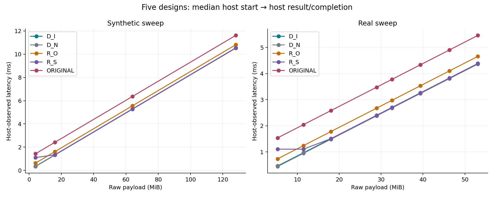
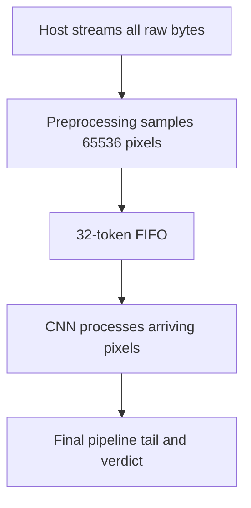
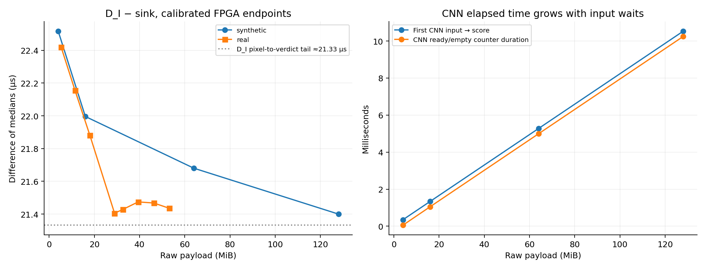
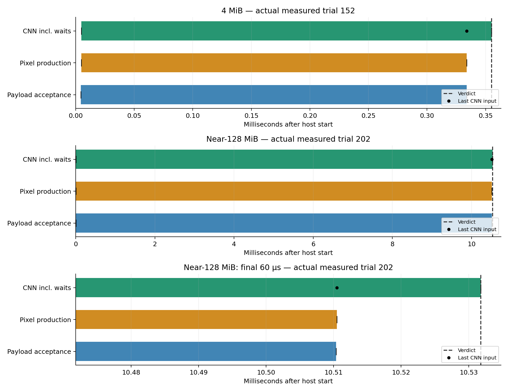
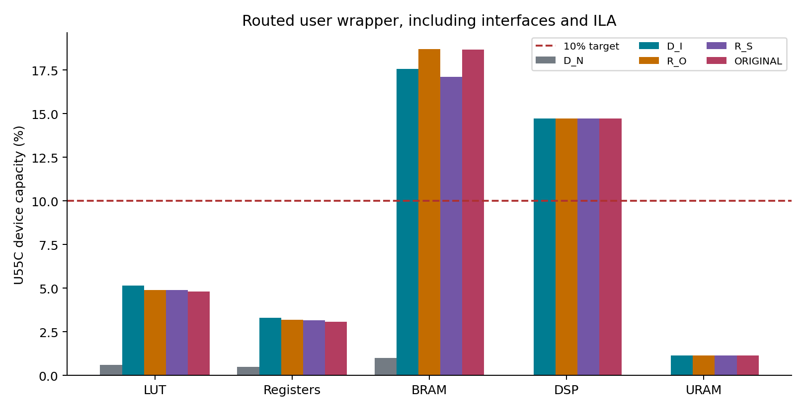

# U55C checker comparison and streaming latency breakdown

Measured **2026-10-09–10**, hacc-u55c-02.

## Outcome

- **Five designs; 12 inputs/design; 20 recorded warmups + 200 measured trials/input.**
- **13,200 main-sweep calls:** 12,000 measured + 1,200 warmups; all functional checks passed.
- R_O and R_S: fresh **260-call production parity + 260-call persistent-context gate** each.
- Original production: fresh **260-call persistent-context parity gate**; frozen FPGA image.
- D_I: **520/520 exact board parity** before its sweep. All checker benchmark outputs match the per-input reference exactly.
- **D_I–sink gap: ≈21–23 µs**, despite an active CNN. Streaming overlaps the CNN with transport; large inputs leave the CNN waiting for pixels.
- **D_I latency ceiling met at 2/12 sizes**; BRAM/DSP caps remain unmet.
- Initial-variant interpretation: **frozen May 24 res256 production checker**, non-streaming and without conv0 optimization; not the earlier HBM-fed I diagnostic.

## Designs and measurement scope

| Design | Scheduling / CNN | Result path | Internal timestamps |
| --- | --- | --- | --- |
| Original production | Sequential preprocessing → original CNN; 65,536-token buffer | Production result DMA | Unavailable |
| R_O | Sequential preprocessing → optimized CNN | Production result DMA | Unavailable |
| R_S | Streaming, 32-token FIFO, original CNN | Production result DMA | Unavailable |
| D_I | Streaming, 32-token FIFO, optimized CNN; separate IPs | Captured logit/verdict via CSR | Available |
| D_N sink | Receive and drain entire frame; no CNN | CSR completion | Transport/completion only |

- Host: **hacc-u55c-02**, U55C, **PCIe Gen3 ×16**, CPU **2**, NUMA **0**, HPF buffers, batch **1**.
- Same four synthetic sizes and eight unchanged real bitstreams; same order seed **20261002**; one session per design.
- Synthetic sizes: **4, 16, 64 MiB; 128 MiB − 64 bytes**. Real sizes: **5.284–53.098 MiB**.
- Every trial transfers the complete input. File I/O, input copies, allocation, registration and FPGA programming are outside timed intervals.
- D_I/D_N: 64-byte header + beat-aligned payload. Production variants: 64-byte header + exact payload, then a **4-byte result DMA**.
- Common plot/table endpoint: **host observes completion/result**. Production timings include Python/ctypes boundaries around flush/predict/readback; D_I/D_N host timestamps come from the native runner. Their host overhead and result paths differ.
- D_I FPGA endpoint: host start → calibrated FPGA verdict. **32 clock-read brackets before and after each size**, affine alignment; worst bracket uncertainty ≈**1.25 µs**.
- No internal preprocessing/CNN times are inferred for uninstrumented production images. No actual PR is performed on benchmark inputs.
- Recorded warmups, measured-only summaries, all-call summaries and first-call latency are retained; no independent cold-start or between-session claim.

## Latency results

**Median host start → host-observed completion, milliseconds.**

| Payload | Original production | R_O | R_S | D_I | Sink |
| --- | ---: | ---: | ---: | ---: | ---: |
| 4 MiB | 1.434 | 0.631 | 1.106 | 0.357 | 0.335 |
| 16 MiB | 2.419 | 1.616 | 1.344 | 1.342 | 1.320 |
| 64 MiB | 6.359 | 5.556 | 5.283 | 5.281 | 5.260 |
| Near-128 MiB | 11.612 | 10.809 | 10.537 | 10.534 | 10.513 |

All 12 sizes, p95, upper confidence bounds, warmup-inclusive statistics and first-call timings: [complete summaries](data/all_variant_summaries.csv). D_I/D_N `median_ms` in those original summaries means the calibrated FPGA endpoint; `median_host_observed_ms` supplies the common host endpoint plotted above. R_O/R_S/Original `median_ms` is host-observed.

**D_I calibrated FPGA endpoint versus the GPU PDF reference:**

| Payload | Median, ms | p95 upper 95% bound, ms | 90% GPU-median ceiling, ms | Meets ceiling |
| --- | ---: | ---: | ---: | --- |
| 4 MiB | 0.355 | 0.358 | 0.405 | Yes |
| 16 MiB | 1.340 | 1.341 | 1.116 | No |
| 64 MiB | 5.279 | 5.398 | 3.951 | No |
| Near-128 MiB | 10.532 | 10.653 | 7.731 | No |

- Passing sizes: **4 MiB synthetic; 5.284 MiB real**. Larger tested sizes miss the ceiling; the crossover remains unlocalized.
- Upper p95 confidence bound: **196th ordered sample of 200**; D_I includes calibration upper endpoints. One-sided, per-case confidence only; no simultaneous-family or multi-session claim.
- [GPU_BASELINE.pdf](data/GPU_BASELINE.pdf) reports GPU **P2P** transfer plus preprocessing, inference and publication/polling; excludes HBM stalls. This experiment starts from **host memory**. These are reference targets, not a matched GPU rerun.

## Why D_I is close to the sink

The sink's endpoint is the last accepted beat; D_I's endpoint is the verdict after all bytes and all **65,536 pixels** have been consumed. The gap is therefore the **unhidden pipeline tail**, not the full CNN compute duration.

Evidence:

1. **Small-input CNN interval ≈0.296 ms** in the two-repeat smoke tests; **4 MiB interval ≈0.350 ms**. The CNN is doing work even when end-to-end overhead versus the sink is much smaller.
2. Near-128 MiB reception lasts **10.506 ms**, ≈**12.78 GB/s**. Pixel production and CNN execution occupy nearly the same interval.
3. Near-128 MiB CNN ready/empty counter: **2,555,962 median cycles**; CNN first-input → score: **2,626,814 median cycles**. Pixel-FIFO backpressure: **0**; median peak occupancy: **13/32 tokens**.
4. Every D_I main-sweep trial records **65,536 produced + 65,536 consumed pixels**, correct input-beat counts, valid event ordering and exact logits. The sink has no preprocessing/CNN events.
5. Last preprocessed pixel → verdict is **≈21.33 µs across the sweep**. D_I–sink median differences are **≈21.4–22.5 µs**.
6. R_O defers inference until preprocessing finishes; R_S streams the original CNN. Original → R_O saves **≈0.803 ms** at every synthetic size; R_O → D_I saves another **≈0.274–0.275 ms** in host-observed medians. These comparisons support the overlap explanation; they are not direct internal-stage measurements.

For long streams, elapsed latency behaves approximately as **max(transport/preprocessing, overlapping CNN work) + pipeline tail + host overhead**, rather than transfer + preprocessing + CNN durations added together.

The ready/empty counter runs while armed until all CNN input tokens are consumed. Its window is not identical to the first-input → score interval; it is a stall diagnostic, not a precise compute-utilization metric. Checker-minus-sink differences also span different runs and cannot isolate compute time or the causal contribution of one optimization.

## D_I timestamp breakdown

**Measured event offsets from host start, milliseconds; medians of 200 trials.**

| Payload | First raw beat | Last raw beat | First pixel produced | Last pixel produced | First CNN input | Score/verdict |
| --- | ---: | ---: | ---: | ---: | ---: | ---: |
| 4 MiB | 0.004388 | 0.333793 | 0.004749 | 0.333877 | 0.004753 | 0.355210 |
| 16 MiB | 0.004531 | 1.318369 | 0.004892 | 1.318453 | 0.004896 | 1.339785 |
| 64 MiB | 0.004284 | 5.257680 | 0.004645 | 5.257764 | 0.004649 | 5.279096 |
| Near-128 MiB | 0.004243 | 10.510386 | 0.004604 | 10.510471 | 0.004608 | 10.531803 |

- **Preprocessing start/end taps:** first/last output-pixel handshake into the FIFO. First raw acceptance → last pixel includes preprocessing startup and transport stalls.
- **CNN start:** first FIFO read handshake. **CNN end:** score accepted by the controller, including output conversion. This is an observable boundary, not the time its first instruction executes.
- Last CNN input, FPGA arm, DMA acknowledgment and host result observation are also exported. D_I does **not** directly capture the first accepted header beat; FPGA arm is a separate event.
- Score and verdict are captured on the same tick in this design. Pipeline intervals include stalls and **must not be summed**.
- Host submission overhead ≈**1.3 µs**; transfer invocation duration alone is not transfer completion time. Host DMA acknowledgment can precede the final application input handshake due to upstream buffering.

[All per-trial events](data/D_I_events_host_relative.csv) · [all-size event medians](data/D_I_event_medians.csv). Offsets use calibrated host/FPGA clock mapping. Six displayed decimals are formatting precision, not nanosecond accuracy. Independent median event offsets need not describe one actual trial.

Each timeline uses one actual measured trial nearest the median verdict latency. The bottom panel magnifies the final 60 µs. The bars deliberately overlap; the CNN bar includes input waiting.

## Resources and next steps

- D_I routed wrapper: **5.15% LUT, 3.32% registers, 17.56% BRAM, 14.72% DSP, 1.15% URAM**.
- R_S BRAM: **17.11%**; R_O **18.70%**. Original production: frozen routed resource evidence; interfaces/debug overhead differ between designs.
- D_I CNN accounts for **328/354 BRAM tiles** and **1,312/1,328 DSPs**. The **10% BRAM/DSP targets remain unmet**.
- [ ] Profile the common host DMA/PCIe path against the sink; identify read-request/completion and memory-throughput limits.
- [ ] Test supported transport settings before proposing another checker build. Current link: **Gen3 ×16**, payload/read request **512 bytes**.
- [ ] Evaluate CNN reuse/buffering tradeoffs for BRAM/DSP reduction; retain parity and latency gates.
- [ ] Use an instrumented production-style build only if internal R_O/R_S event attribution is required; existing images cannot expose it.

## Saved evidence and reproduction

- Raw measurements, clock brackets, environment snapshots, summaries, board parity evidence and hardware/runtime identities: [data/](data/).
- Source-copy hashes: [evidence_manifest.json](evidence_manifest.json). Final package hashes: [file_manifest.json](file_manifest.json).
- Original inputs remain in the frozen dataset/run locations; their paths, sizes and hashes are recorded. Large input files and FPGA images are not duplicated here.
- Collection: `production_host_benchmark.py`; supervised queue: `production_host_queue.py`; report figures/data: `report_board_comparison.py`; narrative tables: `write_board_report.py`. Exact R_O/R_S collector version is saved per variant.
- Existing D_I/D_N measurements retained unchanged; R_O/R_S/Original collected later on the same host. Input order is fixed within each variant; variants were not interleaved.
- Full report package is separate from frozen production artifacts. Completion notifications delivered; final FPGA state: **D_N sink + standard driver**.
